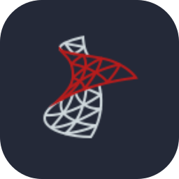
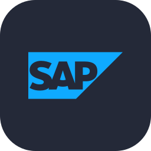
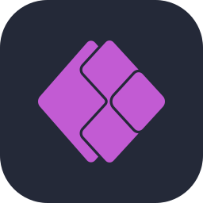
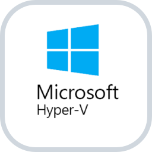
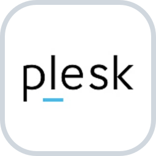
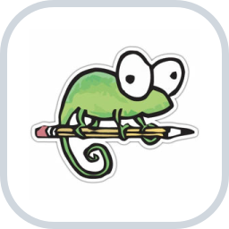

<p align="center">
  
</p>

<p align="center">
  <i>De la web al servidor y de los datos a los videojuegos: si se puede programar, me apunto.<br>
  Programo desde Tenerife, entre el Teide y el Atlántico.</i>
</p>

<p align="center">
  <a href="https://www.linkedin.com/in/daniel-d%C3%B3niz-728455185/"><code>linkedin</code></a> ·
  <a href="https://x.com/mrdoniz"><code>x</code></a> ·
  <a href="https://www.instagram.com/mrdoniz/"><code>instagram</code></a> ·
  <a href="mailto:donizgarciadaniel@gmail.com"><code>correo</code></a>
</p>

### `$ cat perfil.abap`

```abap
REPORT zrp_daniel_doniz.

" Sí, esto es ABAP: el del trabajo. Fuera de horario, toco de todo.
DATA(ls_perfil) = VALUE zcl_perfil=>ty_perfil(
  nombre    = `Daniel Dóniz García`
  isla      = `Tenerife, la isla de la eterna primavera`
  titulo    = `Ingeniero Informático por la Universidad de La Laguna`
  trabajo   = `Desarrollador en DISA`
  filosofia = `si no sé hacerlo todavía, lo aprendo por el camino` ).

DATA(lt_tiempo_libre) = VALUE string_table(
  ( `webs` ) ( `APIs` ) ( `servidores` ) ( `IA` ) ( `bots` ) ( `videojuegos` ) ).

DATA(lo_perfil) = NEW zcl_perfil( ls_perfil ).
lo_perfil->mostrar( lt_tiempo_libre ).
```

### `$ cat tfg.md`

> **[Mejora de diagnóstico de enfermedades neurodegenerativas usando redes LSTM](https://riull.ull.es/xmlui/handle/915/33918)**<br>
> Trabajo de Fin de Grado · Universidad de La Laguna · 2023<br>
> Mejora una solución previa de IA para el diagnóstico y pronóstico del alzhéimer con redes LSTM, a partir de las pruebas ADAS y MMSE.

### `$ ls ~/herramientas`

<table>
  <tr>
    <td><b>Frontend</b></td>
    <td><br><sub>Zustand · Leaflet · PWA</sub></td>
  </tr>
  <tr>
    <td><b>Backend</b></td>
    <td><br><sub>Socket.IO · TypeORM · Zod · JWT y OAuth</sub></td>
  </tr>
  <tr>
    <td><b>Bases de datos</b></td>
    <td>  <br><sub>PostGIS</sub></td>
  </tr>
  <tr>
    <td><b>IA y datos</b></td>
    <td><br><sub>Transformers · CUDA · pandas · NumPy · Jupyter · Colab · Kaggle</sub></td>
  </tr>
  <tr>
    <td><b>SAP e integraciones</b></td>
    <td>  <br><sub>ABAP · APIs SOAP y REST</sub></td>
  </tr>
  <tr>
    <td><b>Automatización</b></td>
    <td>  <br><sub>RPA y low-code</sub></td>
  </tr>
  <tr>
    <td><b>Servidores y despliegue</b></td>
    <td>     <br><sub>Caddy · VPS con despliegue continuo</sub></td>
  </tr>
  <tr>
    <td><b>Sistemas operativos</b></td>
    <td></td>
  </tr>
  <tr>
    <td><b>Pruebas y bots</b></td>
    <td><br><sub>Playwright · Supertest · bots de Telegram · Web Push</sub></td>
  </tr>
  <tr>
    <td><b>Juegos y bajo nivel</b></td>
    <td></td>
  </tr>
  <tr>
    <td><b>Imagen y vídeo</b></td>
    <td></td>
  </tr>
  <tr>
    <td><b>Día a día</b></td>
    <td> </td>
  </tr>
</table>

### `$ git log --stat`

<p align="center">
  
</p>
<p align="center">
  
  
  <br>
  
  
</p>

<br>

<p align="center">
  
</p>
